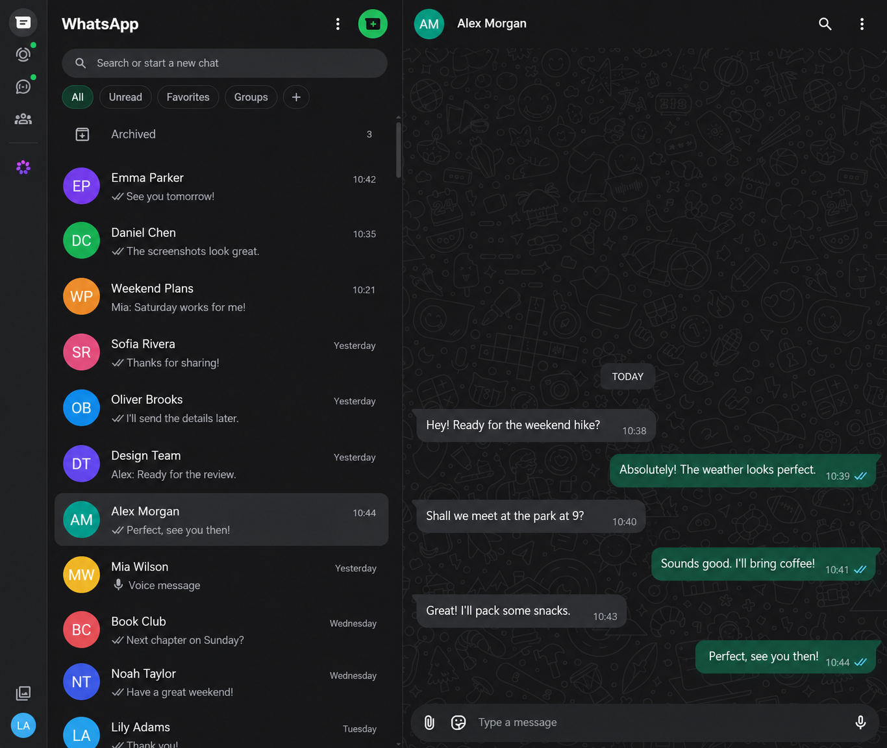

# WhatsDesk


**An unofficial desktop client for WhatsApp Web on Linux.** 

> WhatsDesk was previously called "WhatsApp AppImage". When you upgrade from v2.0.0 or earlier, your existing session and settings are moved automatically from `~/.config/WhatsApp` to `~/.config/WhatsDesk`, so you stay logged in.

A privacy-focused, lightweight Electron wrapper packaged as a universal **AppImage**. Runs instantly on **Ubuntu**, **Debian**, **Fedora**, **Arch Linux**, **Linux Mint**, **Manjaro**, and more—no installation required. 

Includes essential features missing from the web version, like **System Tray support**, **Native Notifications**, and a unique **Privacy "Boss Mode"** to instantly blur your chats.


*The main window (contacts and messages are demo content).*

## Features

- 🚀 **Zero Install**: Just download (or build) the AppImage and run.
- 📱 **Native Experience**: Runs in its own window, separate from your browser tabs.
- � **System Tray**: Minimizes to tray to keep running in the background.
- 🕵️ **Privacy "Boss Mode"**: Instantly blur the screen with `Ctrl+Shift+B` (or `Cmd+Shift+B`).
- 🔒 **Secure**: Chromium sandbox enabled, context isolation, no Node integration in renderer.
- 🛡️ **Hardened**: Secure IPC communication, input validation, URL protocol checking.
- 🔧 **Customizable**: Open source, so you can tweak the Electron wrapper as needed.

## Security

This application takes security seriously. Version 2.0+ includes significant security improvements:

- ✅ **Chromium Sandbox Enabled** - Isolates browser process from system (critical fix!)
- ✅ **Context Isolation** - Separates preload scripts from web content
- ✅ **No Node Integration** - Prevents direct access to Node.js APIs from web content
- ✅ **Secure IPC Communication** - No code injection via executeJavaScript
- ✅ **Input Validation** - All external inputs are sanitized
- ✅ **URL Validation** - Proper protocol checking for external links

For security concerns or to report vulnerabilities, see [SECURITY.md](SECURITY.md).

## Usage

### Running the AppImage

1.  Download the latest `.AppImage` from the [releases page](https://github.com/ramoncardena/whatsdesk/releases) (or build it yourself).
2.  Make it executable:
    ```bash
    chmod +x WhatsDesk-*.AppImage
    ```
3.  Run it:
    ```bash
    ./WhatsDesk-*.AppImage
    ```

### Shortcuts & Tips

- **Privacy Blur**: Press `Ctrl+Shift+B` (or `Cmd+Shift+B` on Mac) to instantly blur/unblur the window. Great for privacy!
- **Minimize to Tray**: Closing the window will minimize it to the system tray. Right-click the tray icon to Quit completely.

### Troubleshooting: Sandbox Errors

**v2.0+ runs with the Chromium sandbox enabled by default for security.** This is the recommended and most secure way to run the application.

If you encounter an error like:
`The SUID sandbox helper binary was found, but is not configured correctly...`

This is common on newer Linux distributions (like Ubuntu 24.04+) that restrict unprivileged user namespaces. You have two options:

**Option A (RECOMMENDED): Enable unprivileged user namespaces**

This is the secure solution that keeps all security protections active:

```bash
# Temporary (until reboot):
sudo sysctl -w kernel.apparmor_restrict_unprivileged_userns=0

# Permanent:
echo "kernel.apparmor_restrict_unprivileged_userns=0" | sudo tee /etc/sysctl.d/99-appimage.conf
sudo sysctl --system
```

**Option B (NOT RECOMMENDED): Run with `--no-sandbox`**

⚠️ **Security Warning:** This significantly reduces security protections. Only use if you understand the risks.

```bash
./WhatsDesk-*.AppImage --no-sandbox
```

When running without sandbox:
- Only use on trusted networks (no public WiFi)
- Keep your system fully updated
- Be aware this removes important security isolation

## Building from Source

Requirements: Node.js (v14+ recommended) and `npm`.

1.  Clone the repository:
    ```bash
    git clone https://github.com/ramoncardena/whatsdesk.git
    cd whatsdesk
    ```

2.  Install dependencies:
    ```bash
    npm install
    ```

3.  Build the AppImage:
    ```bash
    npm run dist
    ```
    The output file will be in the `dist/` directory.

## Development

To run the app in development mode without building:

```bash
npm start
```

## Disclaimer

WhatsDesk is an unofficial wrapper around WhatsApp Web and is not affiliated with, associated with, authorized by, endorsed by, or in any way officially connected with WhatsApp or Meta. The official WhatsApp website can be found at https://www.whatsapp.com. WhatsApp is a trademark of WhatsApp LLC.
